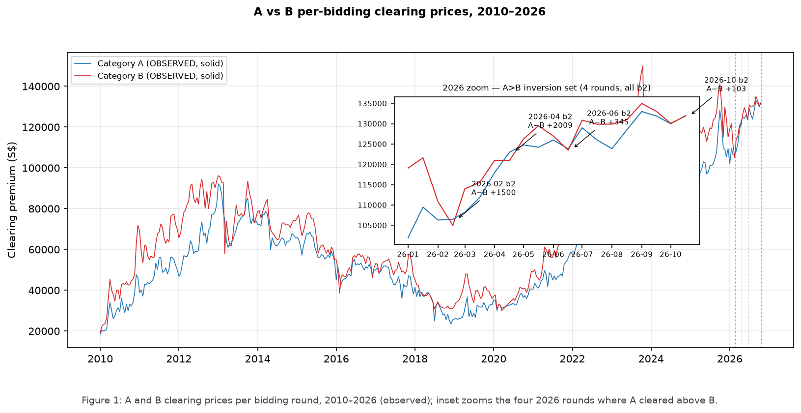
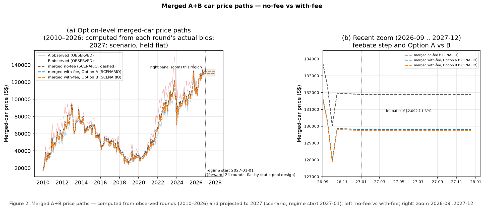
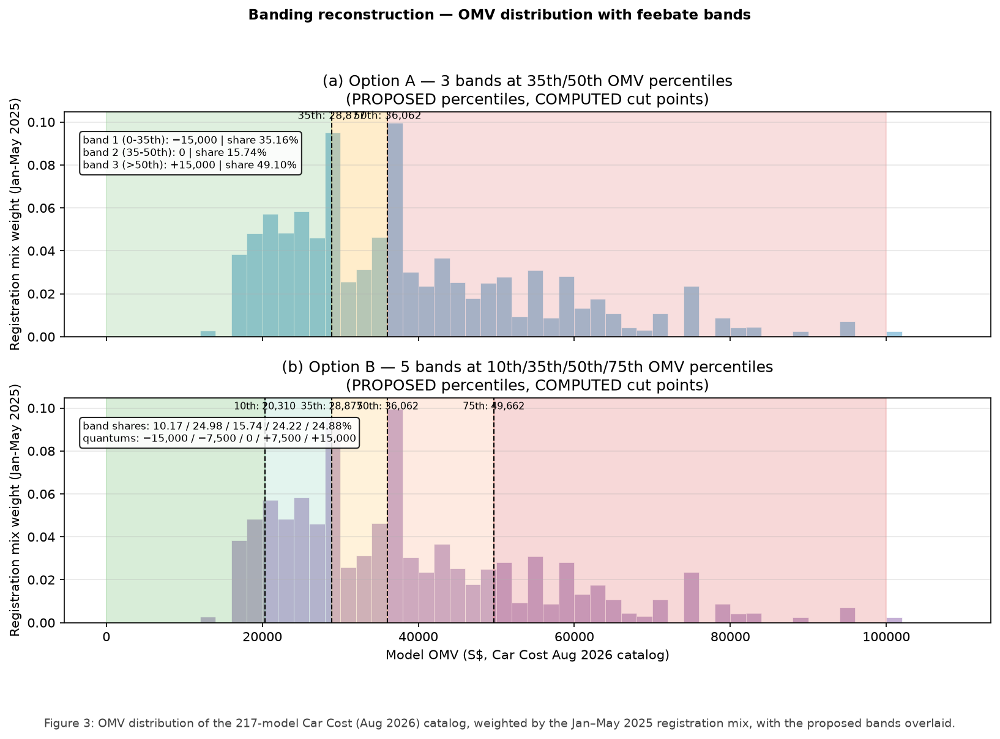
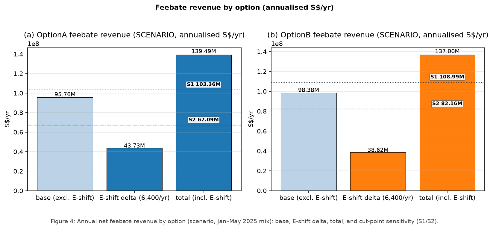
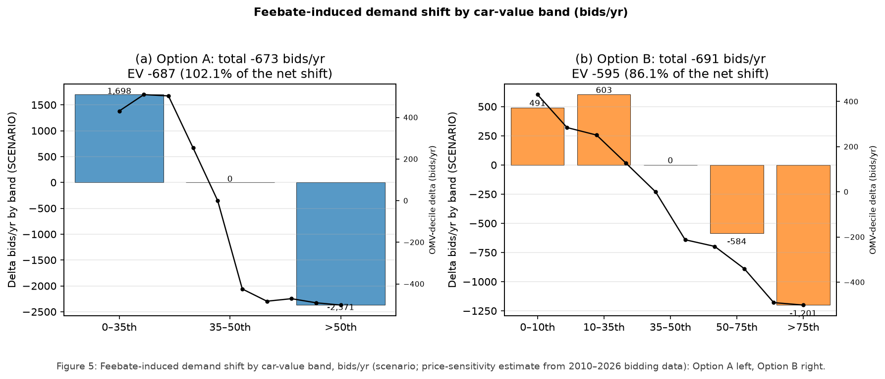
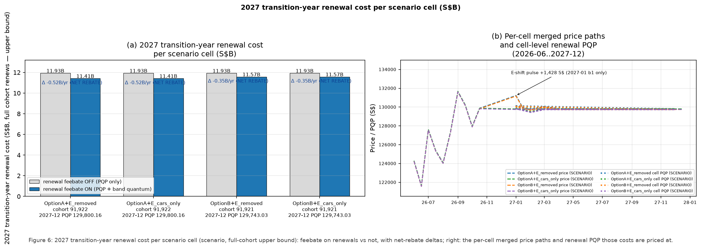
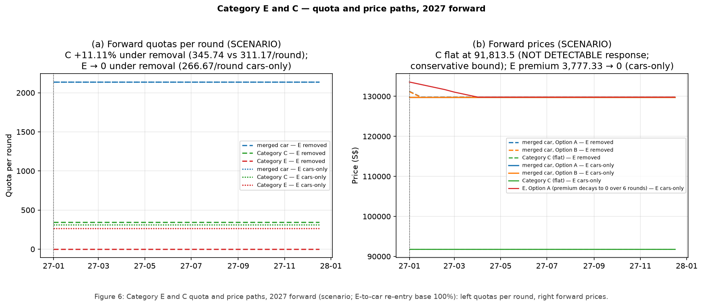
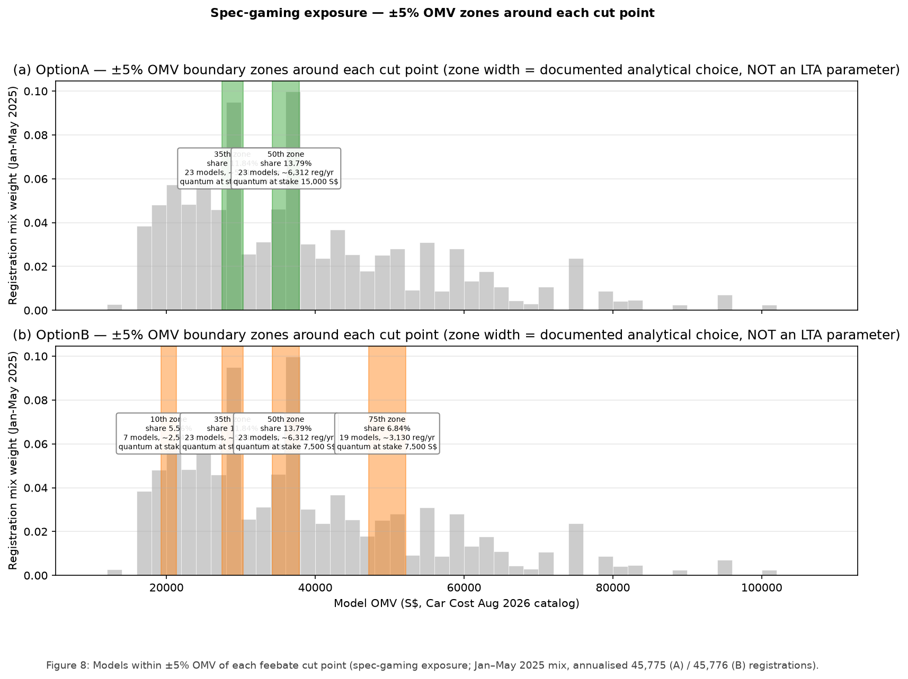

# Merging car COE categories A and B: who pays, and who is rebated?

_Disclaimer: This analysis was prompted by a human, then initially designed and carried out by an AI agent (Hermes + Qwen3.8-27B + [AIOS skillset](https://github.com/thongsia/aios)), and finally shaped and edited collaboratively between the two._

Singapore's Land Transport Authority (LTA) is running a public consultation
(8 Oct – 2 Nov 2026) on how to re-categorise cars for COE
(Certificate of Entitlement) purposes. The core proposal: **merge
Category A ("mass-market" cars) and Category B ("higher-value" cars) into
one passenger-car category** with a single COE price and a single renewal
price (the PQP — LTA's 3-month moving average of COE prices), and add a
**value-based fee-and-rebate ("feebate")**: cars in lower value bands get a
rebate off the COE price, cars in higher bands pay an extra fee. The paper
sketches the feebate in two alternative band structures — **Option A**,
three bands with a S$15,000 rebate / no fee / S$15,000 fee, and
**Option B**, five bands stepping from a S$15,000 rebate to a S$15,000
fee in S$7,500 steps — with the band boundaries set at percentiles of
car values, though the exact dollar cut points are not fixed. The
consultation also reviews the treatment of **Category E** (remove it
entirely, or keep it for cars only) and leaves open the question of whether
the feebate should also apply to **COE renewals**.

This repo contains a data-driven scenario study of that proposal, using 16
years of official COE auction results (2010-01 to 2026-10), a vehicle
registration dataset (2016-01 to 2025-05), LTA's public car
catalog ("Cost for Cars Registered", Aug 2026 edition), LTA's per-model
OMV editions (2017 and 2025), and 24 years of published PQP history
(2002-02 to 2026-09).

**How to read this file:** this README stands on its own — it contains the
proposal, the data, and the main results with the figures behind them. For
second-level detail — the full scenario construction, every table, the
assumptions register, and the automated verification trail — see
[`docs/REPORT.md`](docs/REPORT.md) (the full report) and
[`docs/STATS_SUMMARY.md`](docs/STATS_SUMMARY.md) (a one-page statistics
summary). Every number in this README is quoted from the tables in
`tables/`, and the automated verifier re-checks all of them on every run.

## 1. TL;DR

- **The proposed merge would barely move prices.** The two car categories
  already cost almost the same: in the 19–21 Oct 2026 bidding (2nd
  October 2026 exercise), a Category A COE sold for S$132,004 and a
  Category B COE for S$131,901 — a S$103 difference — and in
  2026, A actually sold *above* B in four rounds (Figure 1). If the two
  had been one category, its price in that same round would have been
  S$131,965; averaged over the last six rounds it is S$131,892, and the
  study assumes it stays at that level through 2027 — right where both
  categories already are (Figure 2).
- **The proposed feebate would be a modest source of government revenue
  — but its size depends heavily on where the value bands are cut.** On
  new car registrations alone, the feebate would raise about S$95.76M/yr
  under Option A and S$98.38M/yr under Option B; adding the 6,400
  cars/yr that would re-enter the car pool if Category E is removed
  brings the total to S$139.49M and S$137.00M/yr. LTA has not yet fixed
  the band cut points: under the two alternatives documented in the
  consultation, the total ranges from S$67.09M to S$139.49M/yr — about
  twofold (for Option A, the new-registration revenue alone ranges
  fourfold, S$23.37M to S$95.76M) (Figure 4, Table 5).
- **The consultation's open question turns a modest revenue into a big
  cost.** If the feebate
  also applies to COE **renewals**, the first cars to renew — those first
  registered in 2017 — are mostly older, cheaper cars that fall in the
  rebate bands. The feebate would then **cost the government S$517.2M in
  2027 (Option A) or S$353.3M (Option B)**: effectively a rebate to
  mass-market renewal owners, who would get back about S$12,600 (A) or
  S$9,261 (B) per car, while current Category B owners would pay about
  S$1,400–1,600 more per car (Figure 6, Table 6).
- **The consultation paper's own banding tables are internally
  inconsistent under public OMVs (LTA's published car values).** In the
  paper's indicative banding tables, 2 rows of Option A's (of 32) and 4
  of Option B's (of 34) flag band lines that no dollar value can
  satisfy: the models the paper itself lists cannot all sit on the
  right side of the line. For example, the paper's Option A table lists
  the Toyota Noah (published OMV S$28,083) below its 35th-percentile
  line and the Toyota Corolla Altis (S$22,200) above it — the cheaper
  car above the dearer one. This is reported as a finding, not
  corrected (Table 4; section 4.3).
- **Under the proposal, the side effects would be real but limited.**
  About 14% of new registrations sit within ±5% of Option A's middle
  band boundary, where the fee changes by S$15,000 — enough incentive for
  buyers to trim a car's spec to just under the line (Figure 8); the
  feebate would also push demand toward cheaper cars (Figure 5); and
  removing Category E would raise the commercial-vehicle category's (C)
  quota by 11% while closing off the fast-track option for buyers who
  need a COE urgently (Figure 7).

Bottom line: **as proposed, the merge would be a low-risk administrative
consolidation at today's prices, and the feebate on new registrations
would be a modest source of revenue whose exact size LTA has not yet
fixed. The number that deserves scrutiny in the consultation is the
renewal question: if the feebate also applies to renewals, that small
revenue stream would flip into a six-figure rebate for each car renewing
in the first year — costing the government half a billion dollars or
more in 2027 alone.** All scenario numbers below are estimates under a
stated 1 Jan 2027 regime start (the paper gives no implementation date)
— they are not predictions.

## 2. The data

Six official sources carry the study (Table 1):

**Table 1. Data sources, the window each covers, and the caveats
(Caveats a–f below) that apply to each.**

| Data | What it tells us | Caveats |
|---|---|---|
| COE bidding results, 2010-01 to 2026-10 (1,990 rows) | Every auction's final price, bids received, and quota sold, per category and per bidding round. Bids are placed mostly by car dealers on their customers' behalf | — |
| Vehicle registrations, 2016-01 to 2025-05 (51,669 rows) | Monthly registrations by make, fuel type and importer — the mix used to value the bands | a, b, d |
| LTA "Cost for Cars Registered", Aug 2026 (217 models) | Per-model OMV (Open Market Value — LTA's official value of a car), fuel type and COE class; the catalog every model is banded against | — |
| LTA per-model OMV editions, 2017, 2018 and 2025 | Historical model-level OMVs (2017 for the renewal cohort; 2018 for the 2028-start renewal sensitivity; 2025 for the cut-point sensitivity) | c, d |
| Published PQP history, 2002-02 to 2026-09 (12,904 rows) | LTA's published renewal prices for categories A–D — used to validate the study's PQP method | f |
| LTA quota allocation, Apr 2010 to 2025 (90-page official PDF) | Historical COE quota splits across categories | — |

Data caveats worth knowing:

**a. The banding mix is pinned to 2025-01..2025-05** (vehicle
registrations). Every mix-based number (band shares, cut points, gaming
zones, feebate revenue) is computed on those five months of
registrations, annualised, and carries that window as an explicit tag.
The window matches the reference mix of the consultation paper's
indicative banding tables — which is why the section 4.3 cross-check is
valid — and the tag records which mix each number was computed under, so
the results stay reproducible if the upstream dataset is later extended.
(At snapshot time the official dataset had not been updated past May
2025.)

**b. 29,463 of 51,669 registration rows (57.0%) carry no vehicle
count** (vehicle registrations) and are excluded consistently; all
estimates state the valid-row base.

**c. The 2025 model-level OMV distribution is not public** (2025 OMV
edition). LTA's 2025 edition publishes model-month *average* OMV only,
so the main banding uses the labelled Jan–May 2025 registration mix ×
catalog reconstruction; the LTA 2025 edition is carried as sensitivity
S1, and uniform model weights as sensitivity S2 (section 4.4).

**d. The renewal cohorts are built from real registrations plus the
vintage-matched LTA OMV edition** (vehicle registrations; LTA OMV
editions): the 2017 cohort (base case) — 4,265 valid car rows, 56
makes; the 2018 cohort (2028-start sensitivity, section 4.6) — 80,281
cars, 52 makes, 99.98% coverage. The 2017 Car Cost PDFs were no longer
available — four probed URLs, all 404 — so the vintage OMV editions are
the best available model-level source.

**e. Used-car markets have no usable data** — the used-car channel is
reported as directional only, never quantified (section 4.8).

**f. No E-category PQP is published** (PQP history) — the published PQP
history covers A–D only, which is fine: the merged-car PQP is a
scenario quantity built from the merged price path.

## 3. What LTA is proposing

All parameters below are **PROPOSED values from the consultation paper**
(29 parameters extracted, each cited to its paper section;
`tables/consultation_parameters.csv`).

Both options define their bands as percentiles of one reference mix —
the **2025 mix**: actual car registrations from January to May 2025
(19,318 vehicles; pinned at 2025-05, section 2 caveat a), valued at the
Aug 2026 catalog's OMVs. The paper sets the band boundaries as
percentiles of this mix, and the study computes the dollar cut points —
and the "share of 2025 mix" column — from it (section 2, caveat a,
explains why the window is pinned).

**Table 2. Feebate Option A — 3 bands, cut points at the 35th and 50th
OMV percentiles of 2025 registrations (PROPOSED band structure; the
dollar cut points are computed by the study from the 2025 mix).**

| Band | Share of 2025 mix | Quantum |
|---|---|---|
| 0–35th percentile (below S$28,877) | 35.16% | −S$15,000 (rebate) |
| 35–50th (S$28,877–36,062) | 15.74% | 0 |
| above 50th (above S$36,062) | 49.10% | +S$15,000 (fee) |

**Table 3. Feebate Option B — 5 bands, cut points at the 10th/35th/50th/
75th percentiles (PROPOSED structure; computed cut points shown).**

| Band | Share of 2025 mix | Quantum |
|---|---|---|
| 0–10th (below S$20,310) | 10.17% | −S$15,000 |
| 10–35th (S$20,310–28,877) | 24.98% | −S$7,500 |
| 35–50th (S$28,877–36,062) | 15.74% | 0 |
| 50–75th (S$36,062–49,662) | 24.22% | +S$7,500 |
| above 75th (above S$49,662) | 24.88% | +S$15,000 |

Beyond the two banding options, the consultation asks:

- **Category E:** remove it entirely (urgent buyers wait for the next
  bidding round) or retain it for car registration only (preserves the
  urgent-buyer channel and shields Category C supply). Since May 2017, E
  has received 10% of A/B/C de-registrations, and in recent years E COEs
  are used predominantly for Category B cars.
- **Renewals (the open PQP question):** should the feebate also apply
  when COEs are renewed?
- **Review cadence:** the banding is to be reviewed **annually**.
- **Implementation date:** the paper states none. The consultation closes
  2 Nov 2026 and LTA findings are due in 1H2027, so a real start is
  more likely 2H2027 or 2028. The study nonetheless anchors every
  scenario at **1 Jan 2027** — the earliest date the regime could
  possibly take effect (the lower bound of the start-date range, not a
  prediction of when it actually starts) — a documented ASSUMPTION
  carried in every scenario label; if LTA later announces a different
  effective date, the scenario labels and the transition-year renewal
  cohort vintage are re-stamped accordingly. The 2028 start is quantified
  as a renewal-cohort sensitivity in section 4.6.

## 4. What we found

### 4.1 The two car categories are already nearly the same price

Category A has traditionally been the cheaper category. By 2026 that
ordering is gone: A cleared *above* B in exactly four rounds of 2026 —
all second biddings (Feb +S$1,500, Apr +S$2,009, Jun +S$345, Oct
+S$103), with more bids on the A side in each round (Figure 1). The
19–21 Oct 2026 round — the latest observed — is the closest: S$132,004
vs S$131,901, a S$103 gap on prices of about S$132,000.

**Figure 1.** A and B clearing prices per bidding round, 2010–2026
(observed); the inset zooms the four 2026 rounds where A cleared above B.



*Solid lines are observed auction results, 2010-01..2026-10. The four
vertical dotted lines mark the rounds where A cleared above B in 2026
(Feb, Apr, Jun, Oct — all second biddings). The inset shows the 2026
zoom with each inversion's spread.*

### 4.2 Merging produces one price, essentially where both already are

Section 4.1 showed the two categories now clear at nearly the same price.
The natural follow-up: once they are merged, what does the single price
come out to — and what would move it?

**The merged price is essentially the price already being paid.** The
study works this out from the actual bids: take each round's bids and
the combined quota (2,137.5 per round — the last six rounds' average,
i.e. the same total number of cars as today), and compute the price a
single merged category would clear at. It does so for every round from
2010 to 2026 (the dashed "back-solved" line in Figure 2, left); in the
last observed round (19–21 Oct 2026) the merged price is
**S$131,965** — within S$40 of the Category A price and S$65 of the
Category B price, because the two prices are now that close. The
scenario holds it flat at **S$131,892** through 2027 (a stated
ASSUMPTION: the same number of bidders, at the same willingness to
pay). In short, the merger itself is price-neutral: it unifies two
prices that are already nearly identical, and creates no price shock.

**The only thing that moves the price is the feebate — and it moves it
slightly down.** Across the mix, the average car pays a net S$2,092
(Option A) / S$2,149 (Option B) more in fees than it gets back in
rebates. Bidders work that into their bids, so the merged price settles
about **1.6% lower**: S$129,873 (A) / S$129,816 (B) at the last
observed round, S$129,800 / S$129,743 by the end of 2027. For the
average car the total outlay (price + fee − rebate) is about the same as
before; the drop is money moving from bidders to the government — the
revenue counted in section 4.4.

The right panel of Figure 2 shows the same merged price under each
scenario variant: four lines, because the two Category-E options
(section 4.7) and the two band structures each shift the price slightly
differently. The renewal-feebate question does not change this price at
all — it only changes what renewal owners pay (section 4.6); the dotted
lines are each variant's renewal price (PQP).

**Figure 2.** Merged A+B price paths, 2010 back-solved to 2027 forward
(scenario, regime start 2027-01); left: no-fee vs with-fee under both
options; right: the four per-cell paths and their renewal PQP lines.



*Faint solid lines are the observed A and B prices. Dashed grey: merged
price with no feebate. Dashed blue/orange: merged price with the
feebate under Option A / Option B. Right panel: the four distinct
per-cell price paths (renewal-feebate toggle pairs are
byte-identical, sha256-verified) with their cell-level renewal PQP
lines, 2027-01 to 2027-12. The small pulse at the 2027-01 round in the
E-removed cells is the one-round Category E shift effect (+S$1,428.14).*

### 4.3 The banding: cheaper cars are rebated, pricier cars pay — and the paper's own tables don't quite add up

Banding the 217 models of the Aug 2026 catalog against the 2025
registration mix gives the shares in Tables 2 and 3: under Option A,
35.16% of registrations fall in the S$15,000-rebate band, 15.74% in the
neutral band, and 49.10% in the S$15,000-fee band (about 16,093 / 7,205
/ 22,477 registrations per year, out of a 45,775 base). Figure 3 shows
the OMV distribution with the bands overlaid for both options.

Cross-validating against the paper's own "typical models" banding
tables: the study's reconstruction agrees with the paper on 24 of 32
rows (Option A) and 18 of 34 (Option B). In the remaining rows — 2 of
Option A's band lines and 4 of Option B's — the paper's own model list
makes the line impossible: the most expensive model it lists below the
line is cheaper than the least expensive model it lists above it, so no
dollar value for the line is consistent with the paper's table (Table
4). This is reported as a finding of the study, not corrected in the
paper's tables (section 4.1 of the report;
`tables/banding_mismatches.csv`).

**Table 4. The six band lines in the paper's indicative tables that no
dollar value can satisfy (public OMVs: LTA Car Cost Aug 2026 catalog;
LTA 2025 edition where the model is no longer catalogued).**

| Option | Band line | Paper lists it below the line | Paper lists it above the line |
|---|---|---|---|
| A | 35th percentile | Toyota Noah (S$28,083) | Toyota Corolla Altis (S$22,200) |
| A | 50th percentile | BYD Sealion 7 Dynamic (S$36,062) | Audi Q3 (S$30,629) |
| B | 10th percentile | BYD E6 (S$26,000) | Hyundai Kona 1.6 HEV (S$19,373) |
| B | 35th percentile | Toyota Noah (S$28,083) | Toyota Corolla Altis (S$22,200) |
| B | 50th percentile | BYD Sealion 7 Dynamic (S$36,062) | Audi Q3 (S$30,629) |
| B | 75th percentile | BYD Sealion 7 Performance (S$45,188) | Honda Civic Type R (S$39,494) |

**Figure 3.** OMV distribution of the 217-model Car Cost (Aug 2026)
catalog, weighted by the Jan–May 2025 registration mix, with the
proposed bands overlaid.



*Top: Option A (3 bands); bottom: Option B (5 bands). Shaded regions are
the feebate bands (green = rebate, amber = neutral, red = fee); dashed
lines mark the computed cut points (PROPOSED percentiles, COMPUTED
dollar values). The mix window is 2025-01..2025-05, frozen at 2025-05,
covering 98.73% of Jan–May 2025 car registrations (19,073 of 19,318).*

### 4.4 The feebate raises modest revenue — but it swings fourfold with the cut points

Annual net feebate revenue under the Jan–May 2025 mix, with and without
the Category E shift flow (6,400 E-de-registered cars/yr re-entering the
merged category, Category-B-skewed mix — a stated assumption with a
50–100% sensitivity; Table 5):

**Table 5. Annual net feebate revenue by option (COMPUTED scenario
estimates, S$/yr; mix window 2025-01..2025-05, frozen at 2025-05).**

| | Option A | Option B |
|---|---|---|
| Base (merged cars, excl. E-shift) | 95,760,000 | 98,377,500 |
| E-shift delta (6,400 cars/yr) | +43,729,050 | +38,624,175 |
| Total incl. E-shift | **139,489,050** | **137,001,675** |
| Sensitivity S1 (LTA-2025-edition cut points), total | 103,359,055 | 108,988,080 |
| Sensitivity S2 (uniform model weights), total | 67,094,156 | 82,164,941 |

The feebate is about **1.8–1.9% of total COE revenue** — modest next to
the multi-billion-dollar COE take — and the net demand response is
negligible (−673 bids/yr under A, −691 under B). The cut-point base
dominates the uncertainty: base revenue alone swings from S$23.37M to
S$95.76M/yr for Option A across the documented variants (Figure 4).

**Figure 4.** Annual net feebate revenue by option (scenario,
Jan–May 2025 mix): base, E-shift delta, total, and cut-point
sensitivity (S1/S2).



*Bars: base revenue (excluding the E-shift), the E-shift delta
(6,400 re-entering cars/yr), and the total including the E-shift. The
boxed values are the two documented cut-point sensitivities (S1: LTA
2025-edition average-OMV cut points; S2: uniform model weights), each
total incl. E-shift.*

### 4.5 Demand shifts toward cheaper cars

Applying the feebate's price effect through the measured (scenario-grade)
demand elasticities: total bidding demand falls by about 673 (A) / 691
(B) bids per year — small in itself — but it redistributes: EV demand
falls (−687/−595 bids/yr), luxury cars (OMV above the S$49,662 top
cut point) fall by about 1,200 bids/yr, and mass-market cars (OMV below
it) gain about 510–530 bids/yr (Figure 5). The feebate tilts the mix
toward cheaper cars.

**Figure 5.** Feebate-induced demand shift by car-value band, bids/yr
(scenario; elasticities from 2010–2026 bidding data): Option A left,
Option B right.



*Bars: the change in bids per year by feebate band. The overlaid line is
the same shift expressed along OMV deciles. Elasticities are
first-difference estimates from 16 years of per-bidding data, graded
A=MEDIUM, B=LOW — scenario inputs, not causal claims.*

### 4.6 If the feebate applies to renewals, it flips to a net cost to the government

This is the consultation's open PQP question, and it is where the sign
flips. The first renewals under a 2027-01 regime are cars whose initial
COE was registered in **2017** (2027 minus the 10-year initial COE
term) — a cohort of **91,922 vehicles** (Option A pricing; 91,921 under
Option B). The cohort skews cheap: under Option A's cut points, 97% of
the pre-Category-A half (average OMV S$22,002, below the 35th-percentile
cut point of S$28,877) and 57% of the pre-Category-B half land in the
rebate bands — 77% of the cohort overall.
The bundled registration file covers Categories A and B only: the 9,640
cars registered under Category E in 2017 (official 2017 total 101,415)
also come up for renewal in 2027 and are not priced here, so the
figures in this section apply to the A+B cohort.

Under the PROPOSED 2025 cut points, pricing the renewal cost at each
scenario cell's own merged PQP (S$129,800.16 for all Option A cells,
S$129,743.03 for all Option B cells, at the 2027-12 end): applying the
feebate to renewals **reduces** the transition-year renewal cost by
**S$517,215,600 (Option A) / S$353,265,450 (Option B)** — a net rebate
to the government's own budget position, delivered to owners (Table 6):

**Table 6. Per-vehicle renewal impact under the feebate (COMPUTED;
2017-vintage cohort banded at the PROPOSED 2025 cut points).**

| | Option A | Option B |
|---|---|---|
| Pre-A owners (old Category A) | **−S$12,628.77** (rebate) | **−S$9,260.73** (rebate) |
| Pre-B owners (old Category B) | +S$1,393.10 (fee) | +S$1,587.45 (fee) |
| Net across the full cohort, per transition year | −S$517,215,600 | −S$353,265,450 |

The renewal-cost figures are upper bounds on the first renewal cycle:
the study assumes the whole 2017 cohort renews in the transition year
(actual renewal behaviour is not modelled). And the effect is
cut-point-base-dependent: re-banding the 2017 cohort at its *own*
2017-vintage percentiles largely neutralises the net rebate — so the
the direction of the renewal effect turns on which year's values LTA uses
for banding renewals (section 6 of the report). The magnitude is also
sensitive to which year's model-level OMV list is used for the banding:
the base case uses the vintage-matched 2017 edition (99.98% coverage);
re-banding the same 2017 cohort against the coarser 2025 edition (93%
coverage) turns the Option A net from −S$517.2M (cost) into
+S$124.9M (revenue) — a year-of-values and list-granularity effect that
public data cannot separate.

**Figure 6.** 2027 transition-year renewal cost per scenario cell
(scenario, full-cohort upper bound): feebate on renewals vs not, with
net-rebate deltas.



*Grey bars: renewal cost with the feebate OFF (PQP only); blue bars:
with the feebate ON (PQP + band quantum). Each cell's label carries its
2017-vintage cohort size and its 2027-12 cell-level PQP. The annotated
deltas are the net rebates to the government (negative = cost to
government, benefit to owners). Pricing basis: each cell's own merged
PQP, never the clearing price.*

**If the regime starts on 1 Jan 2028 instead.** LTA findings are due
1H2027, so 2028 is the more probable effective date (section 3); the
sensitivity is quantified here. The first-renewal cohort would then be
the **2018 cohort — 80,281 vehicles** (official A 39,877 + B 40,216 +
188 unattributed; 12.8% smaller than the 2017 cohort), and the 2017
cohort would renew in 2027 under the old regime, without the feebate.
The 2018 cohort is banded at the same PROPOSED cut points, by the same
method, using the vintage-matched LTA 2018 OMV edition (99.98%
coverage; the edition was fetched 1 Nov 2026 after LTA's scheduled
maintenance and is archived in `verification/`):

**Table 7. First renewal year by regime start (COMPUTED; same method
and full-cohort assumption as Table 6).**

| | 2027 start (2017 cohort) | 2028 start (2018 cohort) |
|---|---|---|
| Cohort size | 91,922 | 80,281 |
| Pre-A owners, per vehicle (Option A) | −S$12,628.77 (rebate) | −S$11,971.69 (rebate) |
| Pre-B owners, per vehicle (Option A) | +S$1,393.10 (fee) | +S$2,450.49 (fee) |
| Pre-A owners, per vehicle (Option B) | −S$9,260.73 (rebate) | −S$9,017.68 (rebate) |
| Pre-B owners, per vehicle (Option B) | +S$1,587.45 (fee) | +S$2,087.14 (fee) |
| Net to the government, Option A | −S$517,215,600 | −S$377,561,400 |
| Net to the government, Option B | −S$353,265,450 | −S$274,526,775 |

The 2028 start shrinks the first-year cost by about 27% (Option A) /
22% (Option B), but does not change its sign: the cohort is smaller and
slightly less skewed to the rebate bands (57.2% in the rebate band under
Option A, vs 60.5% for 2017). The cut-point-base effect works the same
way: re-banding the 2018 cohort at its *own* 2018-vintage percentiles
turns the net into a government revenue of +S$135.2M (Option A) /
+S$143.4M (Option B). The quantum net is PQP-independent, and the flat
forward model carries the 2027-12 cell PQP levels (S$129,800.16 /
S$129,743.03) through to 2028-12, so the rest of section 4.6's
machinery applies unchanged. Derivation:
`src/renewal_cohort_2028_sensitivity.py` →
`data/processed/renewal_cohort_banded_2028anchor.csv`.

### 4.7 Removing Category E relieves Category C, and closes the urgent-bid channel

Under the "E removed" option, 6,400 E-de-registered cars/yr re-enter the
merged car category (assumption: 100% re-entry; sensitivity 50–100%),
producing a one-round price pulse of +S$1,428.14 at the 2027-01
round, and E's former 10% share of de-registrations returns to Category
C: C's quota rises 7,468 to 8,298 per year (+11.11%), with the C price
held flat at S$91,813.5 (C's price response is not detectable in the
data, so flat is the conservative revenue bound; C annual revenue rises
S$685.66M to S$761.87M). Under "E cars-only", E keeps its quota
(266.67/round) but its premium over the merged car price decays from
S$3,777.33 to zero over six rounds (Figure 7). Time-constrained buyers
lose the urgent-bid fast lane either way.

**Figure 7.** Category E and C quota and price paths, 2027 forward
(scenario; E-to-car re-entry base 100%): left quotas per round, right
forward prices.



*Left (a): forward quotas per round under both E options — dashed = E
removed, solid = E cars-only; C (green) gains 11.11% under removal, E
(red) goes to zero under removal. Right (b): forward prices — merged car
(blue/orange, Option A/B), C (green, flat at the conservative bound),
E (red, premium decaying to zero under cars-only). The dotted vertical
line marks the 2027-01-01 regime start.*

### 4.8 Unintended consequences: boundary gaming and classification distortion

- **Band-boundary spec gaming.** Cars within ±5% of a cut point can
  cross the boundary with a small change to the car's declared value —
  with S$15,000 (Option A) or S$7,500 (Option B) of quantum at stake.
  The largest single exposure is Option A's 50th-percentile boundary:
  **13.79% of the registration mix (about 6,312 cars/yr)** sits within
  the zone, with S$15,000 at stake; Option A's 35th-percentile zone
  covers a further 11.84% (about 5,418 cars/yr). Option B's four zones
  cover 5.56% / 11.84% / 13.79% / 6.84% (Figure 8). Crossing a boundary
  requires an OMV move of 5% of the cut point (S$1,443.85 at Option A's
  35th) — small, but not trivial, relative to a S$15,000 payoff.
- **Variant-family classification distortion.** 139 model families (the
  same car name across variants) are examined; under Option A, 12
  families span a band boundary (28 models affected, 12.90% of the
  catalog mis-banded relative to the family mean), with within-family
  quantum differences up to S$15,000 — the largest is the BYD SEAL
  family, whose two models straddle the 50th-percentile boundary (OMV
  S$34,833–37,458). Under Option B: 20 spanning families, 55 models,
  25.35% mis-banded, max difference S$7,500. Buyers of the same car
  name can end up in different bands.
- **Used-car channel (directional only — no usable data).** Three
  directional effects are stated, not quantified: upper-band new cars
  become relatively more expensive (used cars directionally more
  attractive for high-OMV segments); the renewal net-rebate makes
  holding/renewing older low-OMV cars directionally cheaper; and
  E-removal pushes time-constrained buyers directionally toward used
  cars.

**Figure 8.** Models within ±5% OMV of each feebate cut point
(spec-gaming exposure; Jan–May 2025 mix, annualised 45,775 (A) /
45,776 (B) registrations).



*Shaded zones are ±5% OMV around each cut point (Option A top, Option B
bottom); labels give each zone's share of the registration mix, the
number of catalog models inside it, the estimated annual registrations
at risk, and the quantum at stake. The ±5% zone width is a documented
analytical choice of the study, not an LTA parameter.*

### 4.9 What we can and can't claim

- **Can claim:** A and B already clear within about S$103 of each other,
  and the merged category's price, calculated for the same round, comes
  out within S$100 of both; the feebate
  is a modest net revenue source on new registrations (S$137–139M/yr
  base case, S$67–139M/yr across documented sensitivities) that lowers
  the merged price by about 1.6%; applying the feebate to renewals
  flips the sign to a net government cost of S$353–517M for the
  transition year (S$275–378M if the regime starts 1 Jan 2028 instead,
  section 4.6) under the PROPOSED cut points; the paper's indicative
  banding tables are internally inconsistent under public OMVs; and the
  gaming/classification exposures above are real, with the stated
  magnitudes.
- **Can't claim:** any of these as realised outcomes. Every scenario
  number is an estimate under a stated 2027-01-01 regime start (with a
  2028-start renewal sensitivity in section 4.6), the
  registration mix pinned at 2025-01..2025-05 (section 2), scenario-grade
  demand elasticities (no structural
  causal claim), and the stated assumptions (100% E re-entry, full-cohort
  transition-year renewal, flat C price, per-cell PQP pricing). The
  magnitude of the feebate revenue — and of the renewal cost — is
  cut-point-dependent, and LTA's final cut points are not set.

## 5. Under the hood (for the curious)

**How the study works.** Every number in the repo carries one of four
labels: **PROPOSED** (a design parameter of the consultation paper,
cited to its section), **OBSERVED** (fetched official data, with its
window), **COMPUTED** (a scenario estimate from the study's models,
with its data window), or **DIRECTIONAL** (stated, not quantified — no
usable data). Scenario estimates are not predictions. The method follows
standard time-series practice for this kind of question (heteroscedastic
and autocorrelation-robust standard errors, negative controls, graded
evidence ratings); the full method notes, including the banding
reconstruction, the renewal-cohort derivation and the PQP method
validation, are in
[`docs/methodology_notes.md`](docs/methodology_notes.md), and every
source — URLs, fetch timestamps, row counts, sha256 checksums — is in
[`docs/provenance.md`](docs/provenance.md).

**Reproducibility.** Every number in the report traces to a saved table
cell: raw data in `data/raw/`, processed panels in `data/processed/`,
one CSV per table in `tables/`, eight charts in `charts/` (Figures 1–8),
and the reports in `docs/`. The verification module
(`src/verify.py`) re-checks everything from disk on every run: row
counts against the API-stated totals, time anchors and spot prices, the
2026 A>B inversion set, cross-foots to the dollar, scenario invariants
(negative controls), the PQP method against 24 years of published PQP,
scenario-label and freeze-label audits, and sha256 provenance of every
raw and archived file. It also audits the two reports cell by cell —
**zero untraceable numbers is the pass bar** (the current run: 88
checks, 87 pass, 1 documented exception — Option B band shares
cross-foot to 99.99% at 2-dp rounding — 0 fail; see
`tables/verification_report.csv` and
`verification/report_traceability.csv`).

**Re-running it.**

```bash
python3 -m pip install pandas numpy statsmodels matplotlib pymupdf
cd <repo root>
python3 src/env_check.py            # environment access check (writes verification/constraint_report.csv)
python3 src/verify_anchors.py       # raw-data anchors: row counts, spot prices, 2026 A>B set
python3 src/baseline_panel.py       # per-bidding COE panel, 2010-01..2026-10
python3 src/demand_curves.py        # per-category demand curves + evidence grading
python3 src/banding.py              # feebate banding under Options A/B, cut points, shares, mismatches
python3 src/merged_price.py         # back-solved merged A+B price + quota reallocation
python3 src/pqp.py                  # per-cell renewal PQP series + MA-3 method validation
python3 src/fee_price_iteration.py  # with-fee merged price, iterated to convergence
python3 src/fee_revenue.py          # feebate revenue by option + incidence + cut-point sensitivity
python3 src/demand_shift.py         # demand shifts by band / decile / segment
python3 src/ec_scenarios.py         # Category E / C scenarios under both E options
python3 src/renewal_cohort.py       # 2017-vintage renewal cohort banding
python3 src/renewal_cohort_2028_sensitivity.py  # 2028-start renewal sensitivity (2018-vintage cohort)
python3 src/renewal_impact.py       # renewal-holder impacts, priced at cell-level PQP
python3 src/consequences.py         # boundary gaming, classification distortion, used-car directional
python3 src/master_matrix.py        # 8-cell master scenario matrix
python3 src/make_charts.py          # regenerate the eight charts
python3 src/verify.py               # full verification suite (exit 0 iff no failures)
```

The fetch modules (`src/fetch_data.py`, `src/fetch_published_pqp.py`)
re-download the data.gov.sg stores (they fail on count mismatch); the
extraction modules (`src/extract_paper.py`, `src/ocr_annexes.py`,
`src/extract_car_cost.py`) re-parse the bundled PDFs in `docs/` (the
annexes need `easyocr`). All outputs are already bundled — re-fetching
and re-extracting are only needed if you want to refresh the data.

**Repository layout.**

```
README.md                        ← this file
docs/REPORT.md                   ← full report (machine-checked citations)
docs/STATS_SUMMARY.md            ← one-page statistics summary
docs/methodology_notes.md        ← method notes (banding, renewal cohort, PQP)
docs/provenance.md               ← sources, fetch timestamps, row counts, checksums
docs/consult_paper.pdf           ← the LTA consultation paper (public document)
docs/annex_b.pdf, annex_c.pdf    ← image-only annexes (B: merger mechanics; C: banding method)
docs/car_cost_aug2026.pdf        ← LTA "Cost for Cars Registered" (Aug 2026, 217 models)
data/raw/                        ← COE bidding results + vehicle registrations, as fetched
data/processed/                  ← per-bidding panel, PQP series, per-cell price paths, renewal cohort
tables/                          ← one CSV per reported table (+ tables/renewal/ per scenario cell)
charts/                          ← the eight figures shown above (Figures 1–8)
src/                             ← ordered Python modules (env check → anchors → panel → exhibits → charts → verify)
verification/                    ← audit trail: constraint report, invariants, cross-foot log,
                                    traceability audit, label audits + archived source files
batch_handoff_*.json             ← expected-value snapshots used by the cross-checks
```
